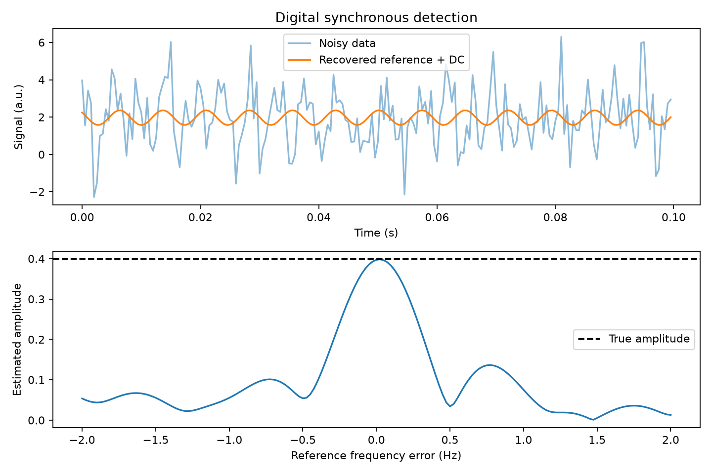

# Digital lock-in signal recovery — OptiIA Consulting

Estimate amplitude and phase of a modulated optical signal using synchronous least-squares detection.

Reproducible project example using synthetic data. No proprietary code or datasets are included.



## Run

Python 3.12 recommended. From this repository:
```bash
python -m pip install -r requirements.txt
python -m unittest -v test_analysis
python analysis.py --seed 42 --out results
```

The script regenerates the data, plots and metrics in `results/`. The root `preview.png` and `metrics.json` show the seed-42 example. Change `--seed` to inspect another realization. Import the functions in `analysis.py` for your own arrays; review their units and input requirements first.

## Method

Fit cosine, sine and DC columns jointly at a known reference frequency. Recover amplitude as hypot(cosine coefficient, sine coefficient) and phase with atan2(-sine, cosine). Export the recovered signal, residuals and frequency-mismatch sensitivity. Compare multiple random noise realizations in tests.

## Assumptions and limits

Single stationary reference with known frequency, uniform sampling and sufficient phase coverage. This is an offline block estimator, not real-time hardware or a low-pass filter implementation. Frequency drift, clipping and reference jitter require separate treatment. Units are arbitrary and phase is relative to the supplied clock.

Metrics describe this synthetic example only. Real measurements require representative data, calibrated inputs and independent validation.

## Validation

Four automated tests check analytical/noiseless references, independent inputs or noise realizations, and invalid inputs. See `test_analysis.py`.

## Applications

Scientific data analysis, numerical optics and Python automation for research workflows. This example is independent of the other projects in the [portfolio](https://github.com/yaghi-ali).

OptiIA Consulting · contact@optiia-consulting.fr · https://www.optiia-consulting.fr
